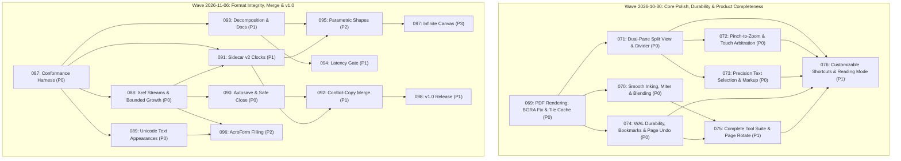

# Implementation Plans

Generated by the `/improve` skill on 2026-08-21 for **Inkwell**. Execute in the order below unless dependencies say otherwise. Each executor: read the plan fully before starting, honor its STOP conditions, and update your row when done.

## Execution order & status

| Plan | Title | Priority | Effort | Depends on | Status |
|---|---|---|---|---|---|
| 001 | PDF Import Robustness & Universal PDFium Fallback | P1 | S | — | DONE |
| 002 | PDFium Tile Rasterizer Aspect & Bounds Fix | P1 | S | 001 | DONE |
| 003 | Dual-Pane Split View Architecture & Navigation | P1 | M | 002 | DONE |
| 004 | Tauri v2 Dialog Plugin Binding & File Loading Wiring | P2 | S | 001 | DONE |
| 005 | Deep PDFium DLL Search, PDF Normalised Save, and Right Panel UI Toggle | P1 | S | 001 | DONE |
| 006 | PDFium Singleton Cache + Visible Tile Error UI | P1 | S | 001,002 | DONE |
| 007 | Performance, Page Positioning, Independent Split Zoom, & PDF Y-Axis Save Coordinate Fix | P0 | M | 006 | DONE |
| 008 | Fix PDF Page Positioning & Aspect Ratio Distortion | P0 | S | — | DONE |
| 009 | Polished Split View with Independent Zoom, Page Selectors, & Divider | P1 | M | 008 | DONE |
| 010 | Rendering Performance — Tile Grid, Debouncing, & Memory Budget | P2 | M | 008 | DONE |
| 011 | Codex Handoff — Rotation/Height, Highlighter Transparency, Sidebar Collapse, & Zoom Controls | P0 | M | 008,009 | DONE |
| 012 | Sidebar Collapse CSS Fix & Dedicated Zoom Toolbar Buttons | P1 | S | — | DONE |
| 013 | PDFium Document Handle Caching & Zero-Copy RGBA Tile Transfer | P0 | M | — | DONE |
| 014 | Stroke Canvas RAF Debouncing, Layout Cache, & Eraser Bug Fix | P0 | S | 013 | DONE |
| 015 | UI/UX Pro-Max Touch Targets, Focus Rings, Tool Cursors, & Glassmorphic Toasts | P1 | S | — | DONE |
| 016 | Stroke Path2D Object Caching & Non-Blocking Async WAL Disk Sync | P1 | M | 014 | DONE |
| 017 | WAL Crash Recovery Toast, Laser Pointer Decay, & Root AGENTS.md | P2 | S | 015 | DONE |
| 018 | Header Open PDF Button, File Drag-and-Drop, & Canvas Welcome Dropzone | P0 | S | — | DONE |
| 019 | Fix Native File Dialog Deadlock & File Input DOM Placement | P0 | S | 018 | DONE |
| 020 | Zero-Latency Inking Pipeline, DOM Layout Thrashing Elimination, and Path2D Retention | P0 | S | — | DONE |
| 021 | PDFium Document Handle Caching, Sub-Rectangle Rasterization, and Thread Pool Offloading | P0 | M | — | DONE |
| 022 | Multi-Document Tab Backend Synchronization and Full Mutation State Durability | P0 | M | — | DONE |
| 023 | Security Hardening: UTF-8 Search Slicing, DLL Hijacking Prevention, CSP, and Input Validation | P0 | S | — | DONE |
| 024 | Touch & Stylus Ergonomics: Palm Rejection, Pinch-to-Zoom, Drawer Animations, and Chisel Geometry | P1 | M | 020 | DONE |
| 025 | Spatial Indexing for Eraser/Lasso Hit-Testing and Thumbnail DOM Virtualization | P1 | M | 020 | DONE |
| 026 | Accessibility Hardening: 44px Touch Targets, Modal Focus Traps, and State Indicators | P1 | S | — | DONE |
| 027 | Page Lifecycle Repair, Viewport Layout Synchronization & Customizable Page Insertion Dialog | P0 | S | — | DONE |
| 028 | Multi-Document Tab Backend Session Synchronization & Backend State Isolation | P0 | M | 027 | DONE |
| 029 | Frictionless Viewport Physics: RAF Wheel Decoupling, Progressive LOD-0 Underlay, and Virtualized Thumbnails | P1 | S | 027 | DONE |
| 030 | Page Management Suite & Paper Background Templates | P1 | M | 027 | DONE |
| 031 | Precision Navigation Suite: Direct Go-to-Page Modal (Ctrl+G), Stylus Barrel Actions & Comprehensive Shortcuts Matrix | P1 | S | 027 | DONE |
| 032 | Configurable Autosave After Delay & Non-Blocking Dirty State Engine | P0 | M | 028 | DONE |
| 033 | Universal WAL Durability & Comprehensive Crash Recovery for All Mutations (Images, Text, Layout) | P0 | M | 032 | DONE |
| 034 | Resilient PDFium Fallbacks, Corrupt Document Recovery & Graceful Degradation | P1 | S | — | DONE |
| 035 | Smooth Viewport RAF Pipeline & Memory Footprint Optimization (Inertial Momentum, Texture Bounding) | P1 | M | — | DONE |
| 036 | Session State Persistence & Multi-Tab Crash Restoration (LocalStorage Session Index, Auto-Reload) | P1 | S | 033 | DONE |
| **037** | **High-Precision Character-Level Text Selection Engine & Complete Overhaul** | **P0** | **M** | **—** | **DONE** |
| **038** | **Complete Modular ES Frontend Cutover, Feature Porting & `app.js` Decommissioning** | **P0** | **M** | **037** | **DONE** |
| **039** | **Rust Core & Backend Compiler Warning Elimination and Cross-Platform Cleanup** | **P1** | **S** | **—** | **DONE** |
| **040** | **Frontend Modular Test Suite & E2E Verification for `inkwell-app`** | **P1** | **S** | **038** | **DONE** |
| 041 | Save Pipeline Integrity — Stroke Identity, Full-State Sync & IPC Arg Contracts | P0 | M | — | DONE |
| 042 | Zoom Controls Repair — Methods, Presets, Live Display & Shortcuts | P0 | S | — | DONE |
| 043 | Text Toolchain Restoration — Selection Activation, Copy Path, Sticky Notes & Search Drawer | P0 | M | — | DONE |
| 044 | Persist Sticky Notes as Real PDF Text Objects | P1 | M | 041 | DONE |
| 045 | Real Verification Baseline — Honest Smoke Suite, Dead E2E Retirement, CI & Docs Truthing | P1 | M | 041,042,043 | DONE |
| 046 | Interactive Performance Wave — Raw Tile Bytes, Pointer-Path Throttling, Redraw Culling | P1 | M | (after 045) | DONE |
| 047 | Error Surface & Session-Lifecycle Honesty — No Swallowed Failures, Working Quit-Save, Dead UI Triage | P2 | S–M | 041,043 | DONE |
| 048 | Viewport Engine Geometry & Tile Rasterization Scale Clamping | P0 | S–M | — | DONE |
| 049 | UI Modal Action Wiring, Focus Trapping & Accessibility Polish | P1 | M | — | DONE |
| 050 | Inking Pipeline Streamlining, Spatial Eraser & Lasso Matrix Transformations | P1 | M | — | DONE |
| 051 | PDF Annotation Integrity, Undo/Redo IPC Synchronization & Durability Hardening | P0 | M | — | DONE |
| 052 | Page Insertion Runtime TypeError Fix | P0 | S | — | DONE |
| 053 | Document Text Layer & Search State Isolation on Open | P1 | S | — | DONE |
| 054 | Viewport Zoom & Pinch-to-Zoom Horizontal Pan Clamping | P1 | S | — | DONE |
| 055 | WAL Undo/Redo Mutation Synchronization for Images, Text & Batch Deletions | P0 | M | — | DONE |
| 056 | Backend Page Dimensions Cache Invalidation on Page Mutations | P0 | S | — | DONE |
| 057 | Windows WebView2 DirectManipulation Touchpad Pinch-to-Zoom | P1 | M | — | DONE (superseded by 072) |
| 058 | v0.2.0 Cross-Platform Release Packaging & Durability Hardening | P0 | M | — | DONE |
| 059 | Lossless Media Sidecar Serialization & Annotation Isolation | P0 | M | — | DONE |
| 060 | Inking Performance & Hardware Stylus Ergonomics | P0 | S | — | DONE |
| 061 | State & Transaction Integrity | P0 | S–M | — | DONE |
| 062 | PDF Standards & Incremental Save Durability | P0 | M | — | DONE |
| 063 | Backend Tile Cache Concurrency, Memory Budget & Normalisation Caching | P1 | S–M | — | DONE |
| 064 | Page Management Suite & Thumbnail Rail Navigation | P1 | M | 061 | DONE |
| 065 | Vector Clipping to Obsidian & LaTeX | P1 | S | — | DONE |
| 066 | Security Hardening, CI & Repository Workspace Unification | P2 | S–M | — | DONE |
| 067 | Correctness, Shortcuts Wiring & Canvas Guideline Cache | P0 | S | — | DONE |
| 068 | Touch Targets & A11Y Ergonomics Polish | P1 | S | 067 | DONE |
| **069** | **PDF Rendering Fidelity, BGRA Channel Fix, Annotation Isolation & Tile Cache Scale** | **P0** | **S–M** | **—** | **DONE** |
| **070** | **Zero-Latency Smooth Inking Pipeline, One-Euro Restoration, Miter Geometry & Canvas Blending** | **P0** | **M** | **069** | **DONE** |
| **071** | **Dual-Pane Split View Architecture, Draggable Divider & Active Pane Synchronization** | **P0** | **M** | **069** | **DONE** |
| **072** | **Touch & Trackpad Pinch-to-Zoom, Gesture Arbitration & WebView2 Host Zoom** | **P0** | **M** | **071** | **DONE** |
| **073** | **Precision Text Selection Engine, Cross-Page Ranges, Multi-Line Search & Text Markup Annotations** | **P0** | **M–L** | **071** | **DONE** |
| **074** | **WAL Crash Recovery Integrity, Structural Page Durability, Bookmark Persistence & Undoable Page Ops** | **P0** | **M–L** | **069** | **DONE** |
| **075** | **Complete Tool Suite: Editable Text Notes, Arrow & Polygon Shapes, Interactive Ruler & Page Rotate** | **P1** | **M** | **070,074** | **DONE** |
| **076** | **UI Polish, Data-Driven Customizable Shortcuts, Dark Reading Mode & Real E2E Verification** | **P1** | **M** | **071–075** | **DONE** |
| **077** | **Annotation Review, Signature & Stamp Studio, Presentation Mode, Lazy Thumbnails & Interaction Polish** | **P1** | **M** | **071, 073, 075, 076** | **DONE** |
| **078** | **Instant PDF Open: Fast Page Sizes, Sidecar Fast Path & Adjacent-Page Prefetch** | **P0** | **M** | **069, 074** | **DONE** |
| **079** | **Non-Blocking Tile Compositor, Single-Clip Page Blitting & Offscreen Dry-Layer Cache** | **P0** | **M** | **078** | **DONE** |
| **080** | **$O(1)$ Incremental Wet Stroke Chunking & Linux Evdev Touchpad Exclusion** | **P0** | **M** | **078** | **DONE** |
| **081** | **Zero-Copy PDFium Tile Pipeline, Prefetch Priority & Backend PageText Cache** | **P0** | **M** | **078** | **DONE** |
| **082** | **Fast AABB Spatial Indexing for Lasso, Selection Bounds, Eraser & RAF Input Coalescing** | **P1** | **S** | **079** | **DONE** |
| **083** | **Hold-to-Snap Smart Shape Recognition (Freehand Ink-to-Shape)** | **P1** | **M** | **080** | **DONE** |
| **084** | **Dual-Mode Eraser: Partial (Segment-Splitting) Vector Eraser & Whole-Stroke Eraser** | **P1** | **M** | **080** | **DONE** |
| **085** | **Smart PDF Export Engine (Page Ranges, Annotated-Pages-Only & Flattened PDF Mode)** | **P2** | **M** | **081** | **DONE** |
| **086** | **External File Modification Watcher & Non-Destructive Cloud Sync Reload** | **P2** | **S** | **081** | **DONE** |
| 087 | PDF Conformance Harness, Round-Trip Property Tests & Crash Torture | P0 | M | — | DONE |
| 088 | Native Xref-Stream Incremental Save & Bounded File Growth | P0 | L | 087 | DONE |
| 089 | Unicode-Correct Text Annotations with Shaped Vector Appearances | P0 | M | 087 | TODO |
| 090 | Spec Autosave, Safe Close Dialog, Non-Blocking Save & Keep Mine / Save a Copy | P0 | M | 088 | TODO |
| 091 | Sidecar v2: Lamport Clocks, Device IDs & Tombstones (CRDT Foundation) | P1 | M | 087, 088 | TODO |
| 092 | Cloud Conflict-Copy Detection & Union Merge | P1 | L | 090, 091 | TODO |
| 093 | Decompose main.js & commands.rs, Retire Dead Code, Fix Doc Drift | P1 | M | 087 | TODO |
| 094 | Measured Ink Latency Harness, HUD & CI Regression Gate | P1 | M | 093 | TODO |
| 095 | Parametric Vector Shapes as Native PDF Annotations | P2 | L | 091, 093 | TODO |
| 096 | AcroForm Field Filling | P2 | L | 088, 089 | TODO |
| 097 | Infinite Canvas Sheets with PDF Page Materialisation (M7) | P3 | XL | 091, 095 | TODO |
| 098 | v1.0 Release Engineering: Signing, Auto-Update, Identity & First Run | P1 | M | 087–092 | TODO |

Status values: `TODO` | `IN PROGRESS` | `DONE` | `UNFIXED` | `BLOCKED (with one-line reason)` | `REJECTED (with one-line rationale)`

> **Note on Wave 2026-10-30 (Plans 069–076: Deep System Audit, Core Polish & Product Completeness)**:
> Generated by `/improve` deep audit on 2026-10-30 against HEAD `c036ee8` using 4 parallel subsystem subagents.
> Resolves BGRA channel swap, missing `/T (Inkwell)` on image/text annotations, boundary tile scale cache misses, and stale tile overdraw (069); bypassed One-Euro filter, zoom-inverted Streamline, $O(N^2)$ wet redraw + commit snap, corner pinching, and `#dry` multiply blend defects (070); dual-pane split view initialization, missing `.split-divider` DOM element, right-pane popover coordinates, and active pane routing (071); two-finger touch pinch stroke leakage (`cancelPendingTouchStroke`), `onGestureChange` `relY` crash, and WebView2 pinch zoom (072); text selection distance weighting, cross-page selection, multi-line search rects, and highlight/underline/strikethrough markup (073); WAL `Truncate`/`Discard` durability, bookmark persistence, cross-sheet object deduplication, and undoable page operations (074); click-to-edit text notes, arrow/triangle shapes, angle-snapping ruler, image insertion UI, and 90° page rotation (075); and data-driven customizable shortcuts, generalized spring-loaded keys, and PDF Dark/Sepia Reading Mode (076).

> **Note on Plan 078 (Instant PDF Open)**:
> Profiling a real 8.8 MB, 33-page textbook found 765 ms spent loading every page just to read its box, plus a 1.1 s debug sidecar object walk. Replaced with `FPDF_GetPageSizeByIndexF` (~1.6 ms), memchr-backed PDF scans, a `/Inkw_Doc` marker fast path, and idle prefetch of the next two page bitmaps. App open fell to ~124–226 ms debug with no change to PDF output.

> **Note on Wave 2026-11-01 (Plan 077: Daily-Driver Review, Signing & Presentation)**:
> Adds an annotation review drawer with filters, search, jump-to-selection, undoable deletion and Markdown summary export; a signature studio (draw/type/stamp presets, saved signatures); chrome-free presentation mode (`F5`, paging, blank-screen cut, laser, state restore); lazily painted thumbnails with per-page annotation badges and fixed image previews; persistent custom colour slots; arrow/triangle shape routing; and a toast/context-menu/settings polish pass. 126/126 desktop checks pass; no Rust changes.

> **Note on Plan 057 (Windows WebView2 DirectManipulation Touchpad Pinch-to-Zoom)**:
> Superseded and addressed in Plan 072 (`072-pinch-to-zoom-gesture-arbitration-and-touch.md`) by removing `--disable-pinch` from `WEBVIEW2_ADDITIONAL_BROWSER_ARGUMENTS` and adding `VisualViewport` / `ctrl+wheel` zoom bridging.

> **Note on Wave 2026-11-06 (Plans 087–098: Format Integrity, Multi-Device Merge & v1.0)**:
> Audit against HEAD `e5fcb71`. Key findings: `PdfFile::open` rejects xref-stream PDFs (most real-world files), so the first save re-serialises them through PDFium and loses the original byte prefix (088); every save session appends a full copy of ink + sidecar on top of earlier BezierNotes revisions, so files grow without bound (088); text-note appearances write UTF-8 into WinAnsi Helvetica, so Bangla/accents are garbled in other readers (089); `FlushPolicy` is unused and autosave defaults to off, the quit dialog's *Cancel* discards work, and the change banner lacks *Keep mine / Save a copy* (090). None of the SPEC §11 format tests exist yet (087), which is why 087 goes first. 091–092 deliver the SPEC §5 CRDT merge for Drive/OneDrive/Dropbox/Syncthing conflict copies.

## Dependency & Priority Graph

## Recommended Execution Sequence

**Current wave (2026-11-06 — Plans 087–098: Format Integrity, Multi-Device Merge & v1.0):**

1. **Wave A — Safety net (do first, alone)**: **087** conformance harness. Expect it to expose the 088/089 defects as known failures.
2. **Wave B — Format fidelity (P0, parallel after 087)**: **088** xref streams + bounded growth, **089** Unicode text appearances, **093** decomposition (no behaviour change; land before 090/092 touch the same files).
3. **Wave C — Survival (P0)**: **090** autosave policy, safe close, non-blocking save.
4. **Wave D — Merge (P1, the headline feature)**: **091** sidecar v2 clocks/tombstones, then **092** conflict-copy merge.
5. **Wave E — Ship v1.0**: **094** latency gate, **098** release engineering.
6. **Wave F — Feature depth (P2/P3, post-1.0 OK)**: **095** parametric shapes, **096** AcroForm filling, **097** infinite canvas.

**Completed wave (2026-10-30 deep audit — plans 069–076):**

1. **Wave 1 — Rendering, Inking, Split View & Gesture Foundations (P0)**:
   - **Plan 069** (PDF Rendering Fidelity, BGRA Channel Fix, Annotation Isolation & Tile Cache Scale)
   - **Plan 070** (Zero-Latency Smooth Inking Pipeline, One-Euro Restoration, Miter Geometry & Canvas Blending)
   - **Plan 071** (Dual-Pane Split View Architecture, Draggable Divider & Active Pane Synchronization)
   - **Plan 072** (Touch & Trackpad Pinch-to-Zoom, Gesture Arbitration & WebView2 Host Zoom)
2. **Wave 2 — Text Selection, Markup & Backend Durability (P0)**:
   - **Plan 073** (Precision Text Selection Engine, Cross-Page Ranges, Multi-Line Search & Text Markup Annotations)
   - **Plan 074** (WAL Crash Recovery Integrity, Structural Page Durability, Bookmark Persistence & Undoable Page Ops)
3. **Wave 3 — Tool Suite Completion, Shortcuts & Reading Experience (P1)**:
   - **Plan 075** (Complete Tool Suite: Editable Text Notes, Arrow & Polygon Shapes, Interactive Ruler, Partial Eraser & Image Insertion)
   - **Plan 076** (UI Polish, Data-Driven Customizable Shortcuts, Dark Reading Mode & Real E2E Verification)

**Completed follow-up (2026-11-01 — Plans 077–078):**

- **Plan 077** (Annotation Review, Signature & Stamp Studio, Presentation Mode, Lazy Thumbnails & Interaction Polish) — DONE; see `077-annotation-review-signature-studio-presentation-polish.md`. No Rust changes were required.
- **Plan 078** (Instant PDF Open: Fast Page Sizes, Sidecar Fast Path & Adjacent-Page Prefetch) — DONE; see `078-instant-pdf-open-page-size-and-prefetch.md`.

**Completed wave (2026-11-01 — Plans 079–086: Extreme Smoothness & Evolution Blueprint) — all DONE:**

1. **Wave 1 — Core Rendering, Inking, Backend & Spatial Smoothness (P0/P1)**:
   - **Plan 079** (`079-non-blocking-tile-compositor-and-offscreen-dry-cache.md`) — DONE: `redrawTiles()` is now fully synchronous (cached tiles blit inside the RAF, misses fetched fire-and-forget), pane+page clips are hoisted once per page instead of once per tile, and an offscreen per-page `#dry` bitmap cache (`invalidateDryPageCache`) makes settled pan/scroll frames a single `drawImage` per page (measured ~0.1–0.3 ms/frame with 300 strokes on a page, zero re-rasterizations).
   - **Plan 080** (`080-o1-wet-stroke-chunking-and-evdev-touchpad-exclusion.md`) — DONE: wet strokes freeze into 32-point `Path2D` chunks accumulated on a device-space layer so each frame only re-rasterizes a ~12-point live tail (tail render ~0.5–1 ms vs 1.4–3.1 ms for a full trace at 700 points, zero commit snap); evdev discovery rejects touchpad/trackpad/Synaptics/TrackPoint/mouse names outright and requires `BTN_TOOL_PEN` unless the device name is a known tablet brand, with unit tests.
   - **Plan 081** (`081-zero-copy-pdfium-tile-pipeline-and-pagetext-cache.md`) — DONE: the full-page bitmap cache now stores pre-normalized opaque RGBA in `Arc<Vec<u8>>` (alpha composited once per page, verified against PDFium's reverse-byte-order default with a red/blue probe PDF), tile crops are one `copy_from_slice` per row instead of a per-pixel blend, `active_tile_renders` makes idle prefetch yield to visible tiles, and a memoized `page_text_cache` backs `get_page_text_data`, `get_page_text_spans` and `search_pdf`; every page mutation now clears both caches via `AppState::clear_page_caches()`.
   - **Plan 082** (`082-aabb-spatial-acceleration-and-raf-input-coalescing.md`) — DONE: `getSelectionBounds` reads the cached page-local `s.bbox` (0.04 ms for 40 selected strokes instead of a full point scan), lasso polygon selection and `findObjectAtWorld` reject whole strokes via polygon/point AABB tests (360-stroke lasso select in ~2 ms), and `text-select` drags now run on display-aligned `pointermove` instead of every `pointerrawupdate`. The eraser already had AABB rejection.
2. **Wave 2 — Next-Gen Inking & Document Workflows (P1/P2)**:
   - **Plan 083** (`083-hold-to-snap-smart-shape-recognition.md`) — DONE: `window.Ink.recognizeFreehandShape` (RDP corner extraction + line/rect/ellipse/triangle classification with RDP, radial-deviation and interior-angle tests) plus a 380 ms stationary dwell in `pen.js` that freezes the snapped vector preview, keeps raw samples for `Esc` / continue-drawing revert, live-adjusts line endpoints on drag, and a persisted "Hold to Snap Shapes" settings toggle. 3 new smoke checks (classifier, real dwell snap, revert).
   - **Plan 084** (`084-dual-mode-partial-and-whole-vector-eraser.md`) — DONE: primary `splitStrokeByCircle` in `eraser.js` densifies long segments, partitions the polyline into outside runs and caps them with exact circle intersections, emitting true vector `buildStrokeRecord` fragments; whole-gesture consolidation (`replaceStrokesWithFragments`) makes one `erase_strokes` + `addedStrokes` transaction for atomic undo/redo and matched WAL `commitStroke`/`deleteStroke` calls; the dock eraser toggles mode on a second click with a toast, tooltip, dot indicator and a partial-eraser cursor. 3 new smoke checks.
   - **Plan 085** (`085-smart-pdf-export-ranges-and-flattening.md`) — DONE: export modal now offers All / Annotated-only / Current / Custom ranges (`parsePageRangeSpec` with clamping, dedupe and reversed-range support) plus a flatten toggle and a 44 px Export Copy button; `export_pdf_custom` builds the page subset through PDFium `FPDF_ImportPages`, remaps the document sheets, writes via `PdfFile::write_document_flattened` (no editable sidecar/`/Inkw_*` markers) and never mutates `pdf_bytes`, the document path, WAL or dirty state. Ctrl+Shift+S/Export As New Copy is now non-destructive too. 3 smoke checks + 6 app-side Rust unit tests (including a real PDFium subset → annotated PDF round-trip) and 2 core flattened-write tests.
   - **Plan 086** (`086-external-file-watcher-and-cloud-sync-guard.md`) — DONE: `AppState::doc_disk_stamp` records `(modified_time, len)` after every open and after our own save (never a false positive), `check_external_file_change` fires once per external modification, and window focus / visibility changes raise a glassmorphic 44 px "changed on disk" banner whose **Reload from Disk** re-opens the file while keeping every unsaved stroke, image, note and bookmark (dirty flag preserved). 2 smoke checks + 2 Rust unit tests.

## Findings considered and rejected

- `Lasso transform and Undo/Redo missing WAL sync in document.js (Subagent 1 CORRECTNESS-05/06)`: Rejected as false positive after vetting — `document.js` emits `documentChanged` via `notifyMutation`, and `main.js:1724-1810` already listens to `undo_add_stroke`, `undo_erase_strokes`, `redo_add_stroke`, `transform_objects`, `undo_transform_objects`, and `redo_transform_objects` and invokes `ipc.commitStroke` / `ipc.deleteStroke` / `ipc.journalImageMutation` / `ipc.journalTextMutation`.
- `Micro-optimization of stroke point smoothing`: Not worth doing because current One-Euro filter in `ink.rs` / `ink.js` already runs in sub-millisecond time.
- `Complete rewrite of PDF parsing in JS`: Not worth doing because Rust `pdfium-render` binding is native, faster, and already handles PDF rendering.
- `Switch to Rust-side TileCache for frontend`: Not worth doing now — JS-side tile grid with zero-copy RGBA transfer provides equivalent performance with minimal IPC changes.
- `Backend pdfium worker-thread + per-bucket bitmap cache (cold tile miss re-parses PDF under global mutex, commands.rs:533-557)`: Real finding (PERF-02), deliberately deferred from Plan 046 — needs a dedicated design for pdfium-render's non-Send `Document`; file as follow-up if pan latency persists after 046.
- `Security hardening parity for open_pdf (no extension/size validation on open path while save_pdf validates)`: LOW risk for a desktop app where the user picks files via native dialog; noted here so it is not re-audited; revisit only if the webview ever renders untrusted content.
- `Predictable temp filename in open_pdf_bytes (commands.rs:419-427)`: %TEMP% is per-user on Windows; symlink/pre-creation risk assessed negligible for this app class.
- `Complete virtual DOM framework rewrite`: Rejected because InkWell's lightweight vanilla ES modular architecture provides lower overhead and better inking response than virtual DOM libraries.
